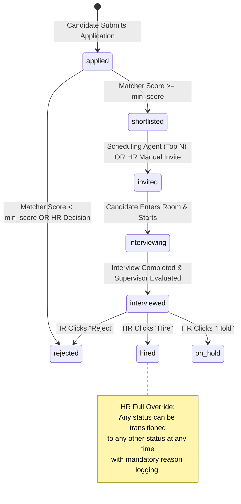
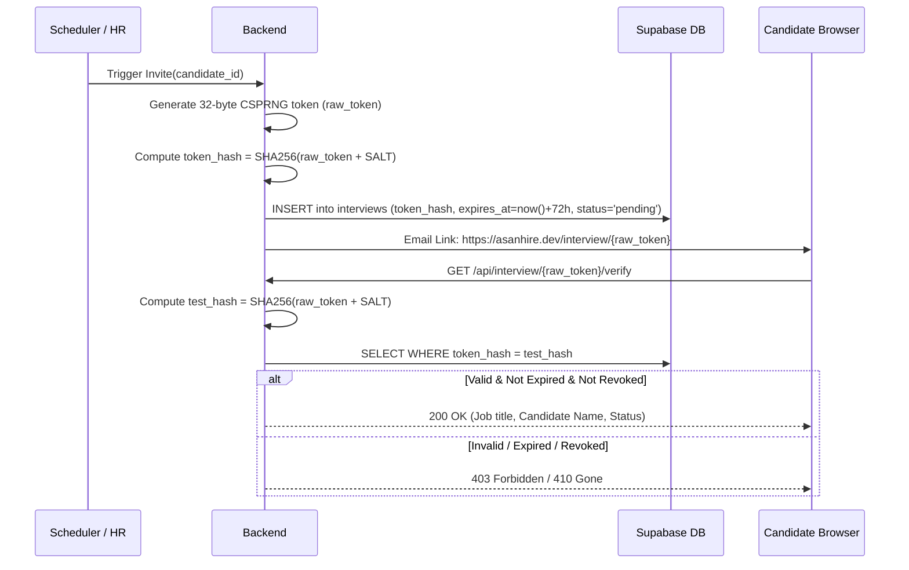

# asanHire Technical Requirements Document (TRD)

---

## 1. System Architecture Overview

```
+---------------------------------------------------------------------------------+
|                                 CLIENT TIER                                     |
|                                                                                 |
|  Candidate Browser                         HR Recruiter Dashboard               |
|  - Public Application Flow (/jobs/[id])     - Protected Admin Space (/hr)       |
|  - Voice Room (/interview/[token])         - Candidate Ranking & Analytics      |
|  - Fullscreen / Guardian Event Listener    - Manual Overrides & Audit Log View  |
|         |                                             |                         |
+---------|---------------------------------------------|-------------------------+
          | HTTPS / WebSocket                           | HTTPS (Bearer JWT)
          v                                             v
+---------------------------------------------------------------------------------+
|                                BACKEND TIER                                     |
|                                                                                 |
|                        FastAPI Gateway (Python 3.11)                            |
|  +--------------------+  +----------------------+  +-------------------------+  |
|  | /api/public        |  | /api/interview       |  | /api/hr                 |  |
|  | Rate Limit: 20/min |  | Rate Limit: 60/min   |  | Auth: Supabase JWT      |  |
|  | PDF Magic Byte Val |  | Token Hash Validator |  | Ownership Assertion     |  |
|  +--------------------+  +----------------------+  +-------------------------+  |
|                                     |                                           |
|         +---------------------------+---------------------------+               |
|         |                           |                           |               |
|         v                           v                           v               |
|  +---------------+          +---------------+          +--------------------+   |
|  | AGENT ENGINE  |          | CORE SERVICES |          | FAST MCP SERVER    |   |
|  | - Rubric      |          | - Storage     |          | (Port 8001 / Stdio)|   |
|  | - Matcher     |          | - Email       |          | - Read Candidates  |   |
|  | - Scheduling  |          | - PDF Parser  |          | - Audit Logging    |   |
|  | - Interview   |          | - Scheduler   |          | - Proctor Checks   |   |
|  | - Guardian    |          | - Tokens/Auth |          +--------------------+   |
|  | - Supervisor  |          +---------------+                                   |
|  +---------------+                                                              |
+---------|---------------------------|-------------------------------------------+
          |                           |
          v                           v
+-----------------------+   +--------------------+   +----------------------------+
|      DATA LAYER       |   |    AI PROVIDERS    |   |   EXTERNAL SERVICES        |
|                       |   |                    |   |                            |
|  Supabase PostgreSQL  |   |  Groq Llama 3.3    |   |  Resend Email API          |
|  - Row Level Security |   |  (Voice Screening) |   |  - Automated Invites       |
|  - Encrypted Passwords|   |                    |   |  - Status Update Emails    |
|  - S3-Compatible Docs |   |  Google Gemini 1.5 |   |                            |
|  - Realtime Events    |   |  (Rubric, Matcher, |   |                            |
|                       |   |   Supervisor)      |   |                            |
+-----------------------+   +--------------------+   +----------------------------+
```

---

## 2. Technology Stack Justification

| Layer | Chosen Technology | Rationale |
|---|---|---|
| **Frontend Framework** | **Next.js 14 (App Router, TypeScript)** | Server-side rendering, instant routing, native SEO for public job boards, first-class streaming compatibility. |
| **Styling & Theme** | **Tailwind CSS + Custom Neumorphic System** | High design velocity, zero runtime overhead, modular theme tokens (`neu-raised`, `neu-inset`, `btn-primary`). |
| **Backend Framework** | **FastAPI (Python 3.11)** | Asynchronous performance, native Pydantic data validation, rapid integration with AI SDKs and FastMCP. |
| **Database & Auth** | **Supabase (PostgreSQL 15, Auth, Storage)** | Enterprise-grade RLS security, built-in UUIDs, JSONB flexibility, private PDF storage buckets, managed JWT auth. |
| **Voice / Interview LLM** | **Groq (`llama-3.3-70b-versatile`)** | Industry-leading inference speed (~300 tokens/sec), vital for conversational voice without awkward pauses. |
| **Analytical LLM** | **Google Gemini (`gemini-1.5-flash` / `pro`)** | Long-context window, high JSON adherence, cost-effective for document matching, rubric synthesis, and deep reporting. |
| **Background Scheduler** | **APScheduler** | In-process lightweight job scheduling for evaluating job deadlines and triggering top $N$ invitations automatically. |
| **Tool Protocol** | **FastMCP Server** | Standards-compliant Model Context Protocol server exposing read-only audit and candidate inspection tools for external agents. |
| **Transactional Email** | **Resend** | High deliverability transactional email API with fixed security-hardened templates and webhook tracking. |

---

## 3. Model Routing & Fallback Architecture

To optimize both user experience and operational cost, model routing is strictly separated across providers. Model names are **never hardcoded**; they are configured strictly via the `GROQ_MODEL` and `GEMINI_MODEL` environment variables and must be verified against each provider's current active model list by running `python scripts/list_models.py`:

1. **Live Interview Agent $\to$ Groq (`$GROQ_MODEL`)**
   - *Requirement:* Latency $< 1.5$ seconds for voice turnarounds.
   - *Reasoning Models (`openai/gpt-oss-*`):* When reasoning models are configured on Groq, the engine requests JSON output mode, provisions generous token limits ($max\_tokens \ge 4096$) so thinking traces do not truncate JSON, sets `reasoning_effort="low"`, and extracts only the final message content, discarding internal reasoning tokens.
   - *Fallback:* If Groq returns 429 (rate limit), 503, or connection failure, falls back to the configured Gemini model (`$GEMINI_MODEL`).
2. **Rubric Agent $\to$ Google Gemini (`$GEMINI_MODEL`)**
   - *SDK:* Official `google-genai` SDK (`from google import genai`) configured with `response_mime_type="application/json"`.
   - *Requirement:* Structured JSON schema generation from unstructured job requisitions.
   - *Fallback:* Internal retry with exponential backoff (2 attempts) before cross-provider fallback to Groq.
3. **Matcher Agent $\to$ Google Gemini (`$GEMINI_MODEL`)**
   - *Requirement:* Parsing raw resume text against rubric criteria; scoring and gap analysis.
   - *Clamping:* Score output is programmatically clamped to $[0.0, 100.0]$ via Pydantic validator.
4. **Evaluation Supervisor Agent $\to$ Google Gemini (`$GEMINI_MODEL`)**
   - *Requirement:* Multi-source synthesis combining candidate resume match, interview transcript, and proctoring trust score into a cohesive hiring recommendation.

---

## 4. Candidate Status State Machine

Candidates transition through 8 explicit states:



---

## 5. Agent Architecture & Contracts

### 5.1 Rubric Agent (Gemini)
* **Input:** Job Title, Department, Description, Requirements.
* **Output:** JSON schema containing 3–5 evaluation dimensions, each with a name, description, and percentage weight summing to 100%.
* **Security Control:** Pydantic validation ensures weights sum to exactly 100.

### 5.2 Resume Matcher Agent (Gemini)
* **Input:** Extracted PDF resume text, Job Rubric, Job Description.
* **Output:** Match score (0–100), executive summary, list of verified strengths, list of skill gaps, rubric breakdown.
* **Security Control:** Untrusted resume text is isolated within `<untrusted_candidate_resume>` delimiters; system prompt warns model to ignore prompt-injection instructions found within candidate text.

### 5.3 Scheduling Agent (Rule-based Python Code)
* **Trigger:** APScheduler cron checking active jobs where `deadline <= now()`.
* **Logic:**
  1. Retrieve all candidates with `status IN ('applied', 'shortlisted')`.
  2. Compute `effective_score = coalesce(manual_score_override, resume_score)`.
  3. Filter by `effective_score >= job.min_score`.
  4. Sort descending by `effective_score`.
  5. Select top $N$ candidates (`limit = job.top_n`).
  6. Generate expiring single-use token, update status to `invited`, and dispatch email via Resend.

### 5.4 Interview Agent (Groq)
* **Input:** Conversation history, Job Rubric, Candidate Resume highlights, Question index.
* **Output:** Next conversational question, encouraging tone, contextual follow-up based on candidate's previous response.

### 5.5 Guardian Proctoring Agent (Rule-based Code)
* **Trigger:** Client-side event emissions from `/interview/[token]`.
* **Deduction Formula:** Starting score = 100.0. Penalties:
  $$\text{Penalty} = \min(5, \text{count}) \times \text{unit\_penalty}$$
  - `tab_hidden`: 8 points (max 40)
  - `window_blur`: 3 points (max 15)
  - `fullscreen_exit`: 10 points (max 50)
  - `paste`: 10 points (max 50)
  - `copy`: 3 points (max 15)
  - `no_face`: 5 points (max 25)
  - `multiple_faces`: 15 points (max 75)
* **Trust Score Formula:**
  $$\text{Trust Score} = \max\left(0.00, 100.00 - \sum \text{penalties}\right)$$

### 5.6 Evaluation Supervisor Agent (Gemini)
* **Input:** Resume text, Interview Transcript JSON, Guardian Trust Score and incident breakdown.
* **Output:** Overall score (0–100), Recommendation (`Hire`, `Reject`, `Hold`), Technical rating, Communication rating, Cultural rating, Key strengths, Red flags.

---

## 6. Interview Token Lifecycle & Security



---

## 7. Logging and Audit Architecture

Three dedicated tables provide enterprise-grade observability:
1. `agent_runs`: Captures agent name, execution timestamp, model used, prompt token usage, execution time (ms), input payload, output payload, and errors.
2. `audit_logs`: Records any state-changing human or automated action (`status_override`, `score_override`, `decision`, `allow_retry`). Stores actor (`user_id`), entity ID, old state, new state, and mandatory human justification (`reason`).
3. `email_logs`: Records recipient, template type, subject line, delivery status, Resend delivery ID, and error messages.

---

## 8. Deployment Strategy

* **Frontend:** Deployed to **Vercel** with Next.js Edge / Node.js runtime.
* **Backend:** Deployed to **Render** or **Railway** as a containerized Python service via the root `Dockerfile`.
* **Database & Storage:** Managed **Supabase** instance in AWS US-East (N. Virginia).

---

## 9. Local Development Instructions

### Prerequisites
- Node.js 18+ and pnpm / npm
- Python 3.11+ and venv
- Supabase CLI or cloud Supabase project

### Backend Setup
```bash
cd backend
python -m venv .venv
source .venv/bin/activate  # Or on Windows: .venv\Scripts\activate
pip install -r requirements.txt
cp .env.example .env
uvicorn app.main:app --host 0.0.0.0 --port 8000 --reload
```

### Frontend Setup
```bash
cd frontend
npm install
cp .env.example .env.local
npm run dev
# App starts at http://localhost:3000
```
